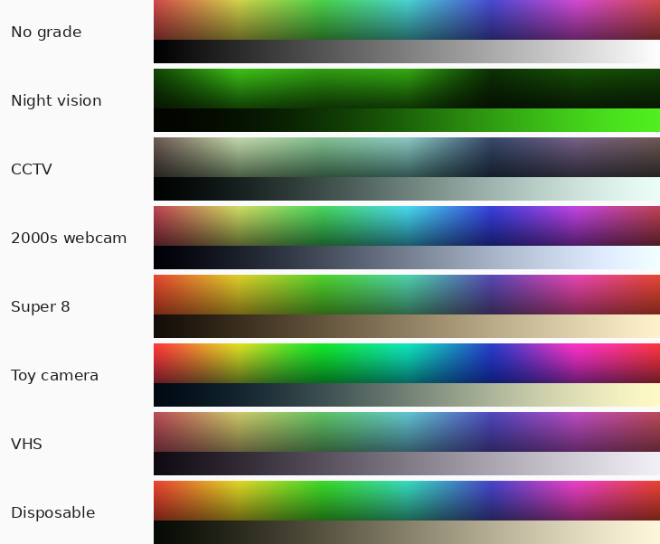

# CharacterLens

**Real lens character and stylised cameras for Octane, rendered in camera.**
A Cinema 4D plugin built on an Octane OSL camera: pick a lens and you get its bokeh, swirl, glow, fringing, distortion and vignetting in the render itself, with no post step and nothing to bake.

`v0.9` · Cinema 4D 2027 · Octane 2026 · single-file plugin

---

## Highlights

- **22 real lenses**, from a 15 mm fisheye to an 800 mm tele, each modelled with its own optics: Seidel aberrations, spectral (per-wavelength) colour fringing, cat-eye bokeh, onion rings, swirl and natural vignetting.
- **26 style cameras**: retro games, old video and film, odd optics and exotic projections, from PS1 wobble to tiny planets.
- **Live film looks** for night vision, CCTV, webcam, Super 8, toy camera, VHS and disposable: colour grade, bloom and grain applied in the render through Octane's own imager.
- **One click to set up.** Select a camera, click **Extensions → CharacterLens**, and it's ready.
- **Simple controls**: seven Look sliders, colour correction, and an Advanced section with every value of the lens if you want to build your own (and save it as a preset).

## Quick start

1. Copy [`dist/CharacterLens.pyp`](dist/CharacterLens.pyp) into your Cinema 4D plugins folder (*Edit → Preferences → Open Preferences Folder… → plugins*) and restart Cinema 4D.
2. Select a camera, or nothing to make a new one from your view, and click **Extensions → CharacterLens**.
   You can also add the **CharacterLens** tag from the Object Manager's *Tags → Extensions* menu.
3. Start Octane's **Live Viewer**. Everything is on the tag's **Character Lens** tab.

The full guide is [`dist/CharacterLens_Guide.pdf`](dist/CharacterLens_Guide.pdf) (3 pages).

## Lenses

| Lens | Look |
|---|---|
| Sigma 15 f2.8 Diagonal Fisheye | real fisheye; circular at 10 mm or below |
| Lensbaby Obscura 16 f90 | very soft, heavy haze, deep focus |
| Nikon Nikkor 20 f4 | vintage wide, barrel distortion, edge fringing |
| Blackwing7 20.7 T1.9 X-Tuned | modern cine, warm with soft glow |
| Cooke Panchro Classic 21 T2.2 | warm, gentle cine (default) |
| Canon FD 24 f1.4 SSC Aspherical | fast vintage wide, coma in the corners |
| LOMO Illumina 25 T1.3 | Soviet cine, cool cast, glow, cat-eye bokeh |
| Pocket Dispo 28 f10 | disposable camera, with a live film look |
| Pinhole f150 | no lens character, near-infinite depth of field |
| Deakinizer #2A 32 T2.1 | heavy swirl |
| Civil War detuned | extreme swirl, fringing and glow |
| 7Artisans Floral Bloom 37 T2.9 | dreamy bloom |
| Voigtlander Nokton Classic 40 f1.4 | classic fast-lens glow |
| Zeiss Ultra Prime 50 T1.9 | clean modern reference |
| Anamorphic 2x 50 T2 | oval bokeh, anamorphic squeeze |
| Canon 50 f0.95 Dream Lens | very shallow and dreamy |
| Angenieux 10x25 zoom 55 T3.7 | warm, hazy 70s zoom |
| Petzval Pro 55 T1.8 | sharp centre, swirling edges |
| Helios 44-2 58 f2 | Soviet swirl |
| Soap Bubble 100 f2.8 (Trioplan) | bright-rimmed bubble bokeh |
| Vivitar Series 1 135 f2.3 | vintage tele, colour fringing in the bokeh |
| Leica Telyt-S 800 f6.3 | extreme tele compression, slight haze |

Presets are set by eye from reference images, not measured from real lenses.

## Style cameras

| Group | Cameras |
|---|---|
| **Games and screens** | PS1 (low-res pixels, with optional vertex wobble), N64 (soft low-res), Doom / Build engine (90° view; looking up or down shears instead of tilting), Game Boy Camera (112-line), CRT TV (scanlines, shadow mask, curved glass) |
| **Video and film** | VHS camcorder ★, Super 8 ★, Toy camera (Holga) ★, 2000s webcam ★, CCTV security ★, Night vision ★, Skate fisheye (VX1000) |
| **Optics and glass** | Peephole, Anaglyph 3D (red/cyan), Prism filter, Kaleidoscope, Compound eye, Frosted glass, Ribbed glass, Underwater (flat port), Tilt-shift miniature |
| **Projections** | Tiny planet, Mirror ball, 360 equirectangular, Isometric (orthographic), Reverse perspective (hypercentric) |

★ have a live film look.

## Live film looks

The starred styles, and the Pocket Dispo lens, finish themselves in the render. Each has a colour grade (a LUT the plugin writes on first start), bloom through Octane's post processing, and per-pixel grain that changes every frame. **Film look** on the tag sets the strength (0 off, 1 as designed, 2 stronger). CharacterLens uses the camera's own Octane Imager and Post processing settings only while a look is on, and puts yours back when you switch away.



## Controls

| Section | Controls |
|---|---|
| **Colour correction** | Exposure (stops), Saturation, Gamma, using the camera's Octane imager, at no render cost |
| **Lens & focus** | Lens, F-stop (down to f/0.02 for extra blur), Focus Object, Focus distance |
| **Look** | Character (everything at once), Bokeh, Swirl, Softness / glow, Fringing, Distortion, Vignette. Each does only its own job: below 1 tones the lens down, above 1 adds more, even on a lens that has none |
| **Style** | Pixel lines, Wobble, Anaglyph eye distance, Film look (shown for styles only) |
| **Advanced** | every value of the current lens (63 in all); *Save as preset…* adds your version to the Lens list |
| **Tools** | Compile shader, Add PS1 snap to selected, Copy shader code, Save shader to a folder… |

## How it works

- **The shader** (`src/template.osl`) is an Octane OSL camera. It traces each ray through a thin-lens model with Seidel aberrations, spectral dispersion, a cat-eye barrel (two sliding rims), a bladed aperture and field-dependent vignetting. Styles swap the projection or add pixelation, scanlines, wobble, glass, prisms and so on.
- **The tag** is CharacterLens's own tag type, so there's no code on it. Every frame it sends the lens preset, your sliders, focus and focal length to the shader's inputs, and drives the camera's Octane imager for colour correction and film looks.
- **The plugin** (`dist/CharacterLens.pyp`) is one file holding the shader, tag logic, presets, the PS1 snap generator and the LUT generator.

## Building and testing

```
cd src
python3 assemble.py        # builds dist/CharacterLens.pyp from the sources
python3 compact.py         # checks the compact shader
cd ../test
python3 mock8.py           # runs the tag logic on every preset without Cinema 4D
```

| File | What it holds |
|---|---|
| `src/template.osl` | the camera shader |
| `src/looks.py` | lens and style presets |
| `src/adv_spec.py` | the Advanced values and their ranges |
| `src/tag_template.py` | what the tag does each frame |
| `src/builder.py` | the tag's layout |
| `src/plugin_template.pyp` | the Cinema 4D plugin: one-click setup, tag type, LUTs |

`CharacterLens_Reference_full.md` is the long technical reference: lens physics, value ranges and how to match a real lens.

## Changes

- **0.9:** one-click setup (no window); the tag sets itself up when added from the Tags menu; live film looks with LUT, bloom and grain; post-process tool removed. CharacterLens is now its own tag type with no code tab. Depth of field merged into F-stop. Look sliders only affect their own part of the look. Gentler preset vignetting. Colour correction moved to the top.
- **0.8:** colour correction, Character Lens tab, a pruned preset list (22 lenses, 26 styles).

## Known limits

- Octane only compiles the OSL camera while the Live Viewer renders through it, so press **Compile shader** if the controls don't change the render.
- Looks that need the finished frames, such as true PS1 palettes, timestamps, rolling shutter and slit-scan, are best done in compositing.
- Plugin IDs are from Maxon's testing range: CharacterLens uses 1000007–1000009 and XenoCam 1000005. Each plugin needs its own number; get registered IDs from Maxon before sharing the plugins widely.
