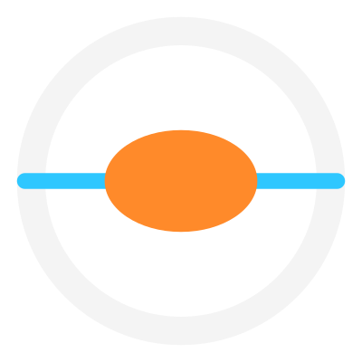

# Lens plugins for Cinema 4D + Octane

Two in-camera lens plugins for Octane in Cinema 4D, made by Einar Bragi for 3D product films. Both are Octane OSL cameras: the lens character is rendered by the camera itself, so it's correct in every pass with nothing to fix in comp.

<table>
<tr>
<td width="50%" valign="top">


### [CharacterLens](CharacterLens/) `v0.9`

**Many lenses and styles.** 22 real lenses, from a Petzval and a Helios to a Soap Bubble Trioplan, plus 26 style cameras (PS1, VHS, Super 8, night vision, tiny planet and more) with live film looks. One click to set up.

[Download `CharacterLens.pyp`](CharacterLens/dist/CharacterLens.pyp) · [Guide](CharacterLens/dist/CharacterLens_Guide.pdf)

</td>
<td width="50%" valign="top">



### [XenoCam](XenoCam/) `v1.1`

**One lens, no presets.** A Cooke-style cine prime set (12–300 mm) whose character follows your focal length, with an Era dial from modern to vintage, anamorphic mode, a Super8 slider and a fisheye switch.

[Download `XenoCam.pyp`](XenoCam/dist/XenoCam.pyp) · [Guide](XenoCam/dist/XenoCam_Guide.pdf)

</td>
</tr>
</table>

## Install

1. Download the `.pyp` file(s) above.
2. Copy them into your Cinema 4D plugins folder: *Edit → Preferences → Open Preferences Folder… → plugins*.
3. Restart Cinema 4D.

Both plugins need **Cinema 4D 2027** and **Octane 2026**, and can be installed side by side.

## Repository layout

```
CharacterLens/
  dist/    CharacterLens.pyp + guide PDF        ← what you install
  src/     shader, presets, tag logic, build scripts
  test/    offline test of every preset (no Cinema 4D needed)
  docs/    README images
XenoCam/
  dist/    XenoCam.pyp + guide PDF
  src/     shader, tag logic, build script
```

Each plugin is a single `.pyp` built from its `src/` folder with `python3 assemble.py`. See each plugin's README for details.
