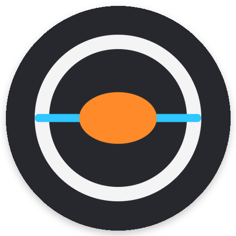

# XenoCam

**One cinematic lens for Octane, with no presets to choose from.**
XenoCam is a classic cine prime set, modelled on the Cooke S4/i family from 12 to 300 mm, as a single Octane OSL camera. Its character follows your camera's focal length, so a 14 mm shot gets wide-angle flaws and a 135 mm shot gets creamy tele bokeh, without you picking a lens.

`v1.2` · Cinema 4D 2027 · Octane 2026 · single-file plugin · built from [CharacterLens](../CharacterLens/)'s lens code

---

## Highlights

- **Follows the focal length.** The set is described at ten focal lengths (12 to 300 mm) and blends smoothly between them.
- **Era dial:** 0 = clean modern glass (Master Prime territory), 0.5 = the classic set, 1 = vintage 70s Speed Panchro, with more glow, swirl, cat-eye and warmth.
- **Spherical or anamorphic.** Anamorphic adds oval bokeh, softer edges and *mumps*: faces and products get a little fatter at close focus, as with real front anamorphics.
- **Super8 slider:** gate weave, rounded gate, grain, exposure flicker, warm faded colour and cheap-zoom fringing, all at once.
- **Fisheye switch:** an equisolid fisheye whose image circle follows the focal length, from a round 8 mm image to a gentle warp at 35 mm.
- **Focus plane tilt** for keeping a long product sharp front to back.

## How the lens changes with focal length

| | Wide (12–25 mm) | Normal (35–50 mm) | Long (75–300 mm) |
|---|---|---|---|
| **Distortion** | gentle barrel, a touch of mustache at 12 mm | almost none | faint pincushion |
| **Corners** | darker and softer | mild | clean and even |
| **Bokeh** | cat-eye toward the corners | slight cat-eye | round, creamy, centre-bright |
| **Colour fringing** | red/cyan toward the corners | low | purple/green on out-of-focus edges |
| **Glow** | little | gentle wide-open glow | gentle glow, a touch of haze at 300 mm |

## Quick start

1. Copy [`dist/XenoCam-1.2.pyp`](dist/XenoCam-1.2.pyp) into your Cinema 4D plugins folder (*Edit → Preferences → Open Preferences Folder… → plugins*) and restart Cinema 4D. Delete any older `XenoCam*.pyp` there first, since two versions can't load side by side.
2. Select a camera and choose **Extensions → XenoCam 1.2 → Set up XenoCam on selected camera**.
3. Start Octane's **Live Viewer** and press **Compile shader** on the XenoCam tag.

Focal length and sensor size stay on the Cinema 4D camera, where you'd normally set them; everything else is on the XenoCam tag. The full guide is [`dist/XenoCam_Guide.pdf`](dist/XenoCam_Guide.pdf).

## Controls

| Section | Controls |
|---|---|
| **Lens & focus** | Fisheye, F-stop, Widest aperture (T2 like the Cooke set), Focus Object, Focus distance, Focus breathing (0 by default) |
| **Look** | Character (0 perfect, 1 as modelled, 2 exaggerated), Era, Format (spherical / anamorphic), Super8, Reset look |
| **Bokeh** | Aperture blades (8, as on the Cooke), Blade roundness, Cat-eye, Bokeh rim |
| **Glow & edges** | Glow, Haze, Swirl, Edge softness, Distortion, Focus plane tilt |
| **Colour** | Fringing, Purple fringing, Vignette, Warmth (about −0.15 for exact product colour), Edge colour cast |

## Building

```
cd src
python3 assemble.py        # builds dist/XenoCam-<version>.pyp
```

`src/XenoCam.osl` is the shader, `src/tag_template.py` the tag logic and `src/plugin_template.pyp` the Cinema 4D plugin.

XenoCam and CharacterLens can be installed side by side; they don't share any settings.
